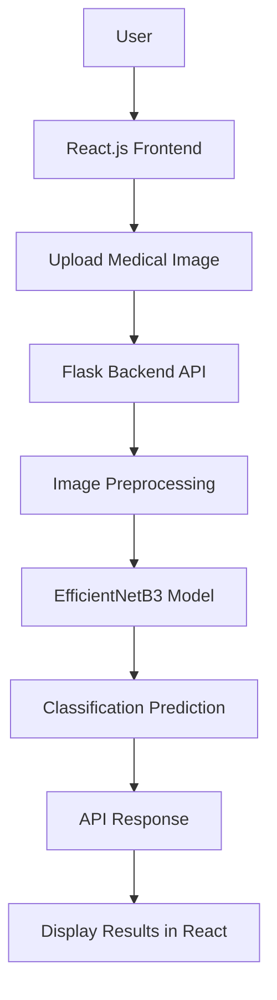
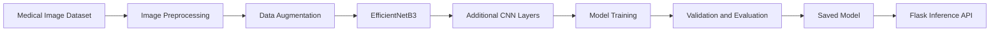

# 🩺 TriScan — Automated Medical Imaging Classification System

**An AI-powered medical imaging classification web application built with React.js, Flask, TensorFlow, and Keras.**

TriScan is designed to support medical image analysis by using deep learning to classify CT scans, MRI scans, and X-ray images. It integrates a React.js frontend with Flask backend APIs to handle image uploads, preprocessing, and model predictions.

> ⚠️ **Disclaimer:** TriScan is an academic and research project intended for experimental medical imaging classification. It is not a substitute for professional medical diagnosis or clinical evaluation.

## 🌐 Live Demo

- **Live Application:** [TriScan Web App](https://triscaner-ai.vercel.app/)
- **GitHub Repository:** [Sachin6389/TriScaner](https://github.com/Sachin6389/TriScaner)

## ✨ Key Features

- 🧠 **AI-Powered Image Classification** — Uses a deep learning model for medical image classification.
- 🩻 **Multiple Imaging Modalities** — Designed to support CT, MRI, and X-ray image inputs.
- ⚡ **Real-Time Prediction API** — Flask backend processes uploaded images and returns model predictions.
- 🔬 **Transfer Learning** — Uses EfficientNetB3 as the foundation of the classification model.
- 🛠️ **Image Preprocessing** — Prepares uploaded images for model inference.
- 📊 **Model Evaluation** — Uses metrics such as AUC, precision, and recall to assess model performance.
- 🌐 **Web-Based Interface** — React.js frontend provides an interface for interacting with the prediction system.
- ☁️ **Cloud Deployment** — Frontend deployed on Vercel and backend deployed on Railway using Gunicorn.

## 🏗️ System Architecture



### How It Works

1. The user uploads a supported medical image through the web interface.
2. The React frontend sends the image to the Flask backend API.
3. The backend preprocesses the image into the format expected by the model.
4. The trained TensorFlow/Keras model performs inference.
5. The backend returns the prediction to the frontend.
6. The frontend displays the returned classification result.

## 🧠 Deep Learning Approach

TriScan uses **transfer learning with EfficientNetB3**, a convolutional neural network architecture, as the foundation of its image classification pipeline.

### Model Development

- **Base Architecture:** EfficientNetB3
- **Framework:** TensorFlow and Keras
- **Learning Approach:** Transfer learning with additional CNN layers
- **Regularization:** Dropout and batch normalization
- **Data Augmentation:** Keras `ImageDataGenerator`
- **Class Imbalance Handling:** Class weights
- **Training Optimization:** Early stopping and learning-rate reduction
- **Checkpointing:** Model checkpointing to preserve selected training weights

### Training Workflow



The model was trained using Google Colab, with Google Drive used for storing training data and model artifacts.

## 📊 Model Evaluation

The training and evaluation workflow includes the following metrics:

| Metric | Purpose |
|---|---|
| AUC | Evaluates discrimination between classes |
| Precision | Measures the proportion of positive predictions that are correct |
| Recall | Measures how effectively positive cases are identified |

Model performance depends on the dataset, class distribution, preprocessing pipeline, and evaluation methodology. Actual numerical scores should be added here once verified from the evaluation results.

## 🛠️ Technology Stack

| Category | Technologies |
|---|---|
| Frontend | React.js, JavaScript |
| Backend | Python, Flask |
| Deep Learning | TensorFlow, Keras |
| Model Architecture | EfficientNetB3, CNN |
| Image Processing | NumPy, ImageDataGenerator |
| Training Environment | Google Colab |
| Model Storage | Google Drive |
| Backend Deployment | Railway, Gunicorn |
| Frontend Deployment | Vercel |
| Development Tools | VS Code, Git, GitHub |

## 🚀 Getting Started

Follow these steps to set up the project locally. The commands below are templates; adjust directory names and entry-point filenames to match the repository.

### Prerequisites

- Python 3
- Node.js and npm
- Git
- A compatible trained model file
- The project dependencies listed in the frontend and backend directories

### 1. Clone the Repository

```bash
git clone https://github.com/Sachin6389/TriScaner.git
cd TriScaner
```

### 2. Set Up the Backend

Navigate to the directory containing the Flask application.

```bash
cd backend
```

Create and activate a Python virtual environment.

**Windows:**

```bash
python -m venv venv
venv\Scripts\activate
```

**macOS/Linux:**

```bash
python3 -m venv venv
source venv/bin/activate
```

Install the required Python dependencies:

```bash
pip install -r requirements.txt
```

Ensure the trained model file and any required configuration are available at the paths expected by the application.

Start the Flask server using the actual application entry point. For example, if the entry point is `app.py`:

```bash
python app.py
```

The local API address and port depend on the Flask configuration.

### 3. Set Up the Frontend

Open another terminal and navigate to the directory containing the frontend's `package.json`.

```bash
cd frontend
npm install
```

Configure the frontend's API base URL to point to the running Flask backend, using the environment variable expected by the project.

For a Vite application, the configuration might look like this:

```env
VITE_API_URL=http://127.0.0.1:5000
```

Use this variable name only if the frontend code supports it.

Start the frontend:

```bash
npm run dev
```

Open the local URL printed in the terminal.

## ☁️ Deployment

### Frontend — Vercel

The React frontend is deployed on Vercel.

Deployment considerations:

- Configure the correct frontend root directory.
- Set the production backend API URL.
- Ensure frontend build commands and output directories match the project configuration.

### Backend — Railway

The Flask backend is deployed on Railway and served using Gunicorn.

Deployment considerations:

- Install all Python dependencies.
- Ensure the trained model is accessible to the application.
- Configure the required environment variables.
- Use a production server such as Gunicorn.
- Configure cross-origin requests if the frontend and backend use different origins.

Example Gunicorn command, assuming the Flask application object is named `app` in `app.py`:

```bash
gunicorn app:app
```

Adjust the command to match the actual module and application object.

## 📁 Repository Structure

The exact directory layout may vary. A typical structure for this application could look like:

```text
TriScaner/
├── frontend/
│   ├── public/
│   ├── src/
│   ├── package.json
│   └── ...
├── backend/
│   ├── app.py
│   ├── requirements.txt
│   ├── model/
│   └── ...
├── README.md
└── .gitignore
```

Update this tree to reflect the actual files and directories in the repository.

## 🔒 Responsible AI and Medical Safety

Medical imaging classification is a high-stakes application area. Model predictions can be affected by image quality, dataset bias, differences between scanners, and differences between training and real-world data.

- Predictions must not be treated as confirmed diagnoses.
- Clinical use requires appropriate validation and qualified medical oversight.
- Model evaluation should include class-wise metrics and independent testing.
- Medical images and related patient information should be handled securely.

## 🔮 Future Enhancements

- Expand and validate the dataset across different imaging sources.
- Add detailed evaluation reports and confusion matrices.
- Improve model explainability using Grad-CAM or similar techniques.
- Add image validation and clearer error handling.
- Improve API testing and automated deployment workflows.
- Evaluate generalization on independent datasets.

## 👨‍💻 Contributors

**Sachin Gond** — AI/ML Development, Deep Learning Model Training, and Full-Stack Integration

- GitHub: [@Sachin6389](https://github.com/Sachin6389)
- LinkedIn: [Sachin Gond](https://www.linkedin.com/in/sachin-buildnex/)
- Portfolio: [sachingondportfolio-zeta.vercel.app](https://sachingondportfolio-zeta.vercel.app/)

**Team Members**
- Anurag Yadav
- Anurag Chaudhary

## 🙏 Acknowledgements

- TensorFlow and Keras for deep learning tools.
- The EfficientNet research and implementation community.
- Google Colab for model training resources.
- Vercel and Railway for deployment infrastructure.

---

⭐ If you find this project interesting, consider starring the [TriScaner repository](https://github.com/Sachin6389/TriScaner).

**Built with Python, TensorFlow, Flask, and React.js.**
